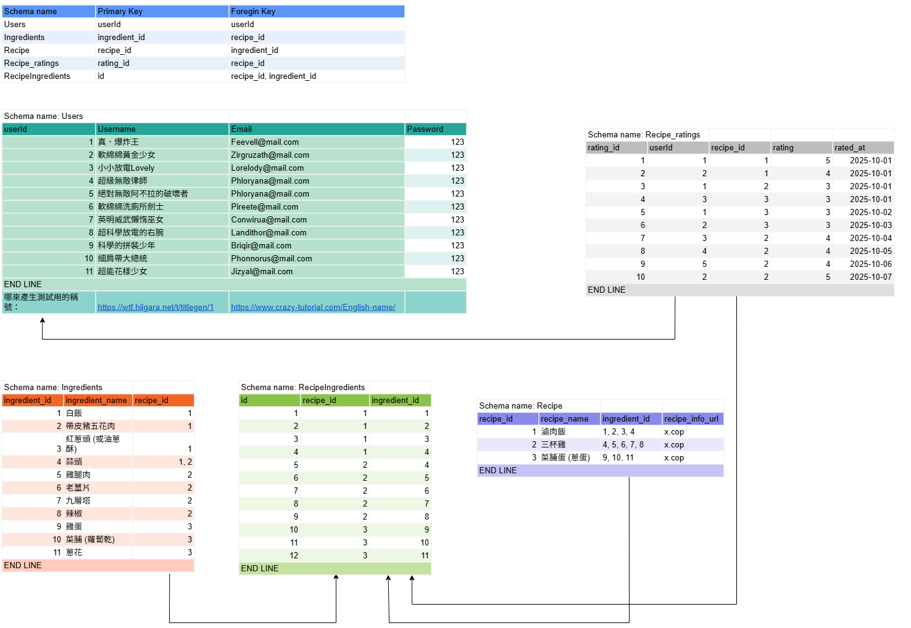
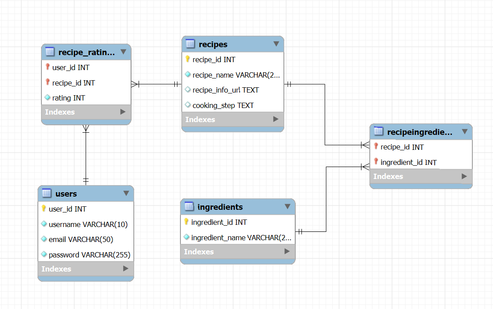
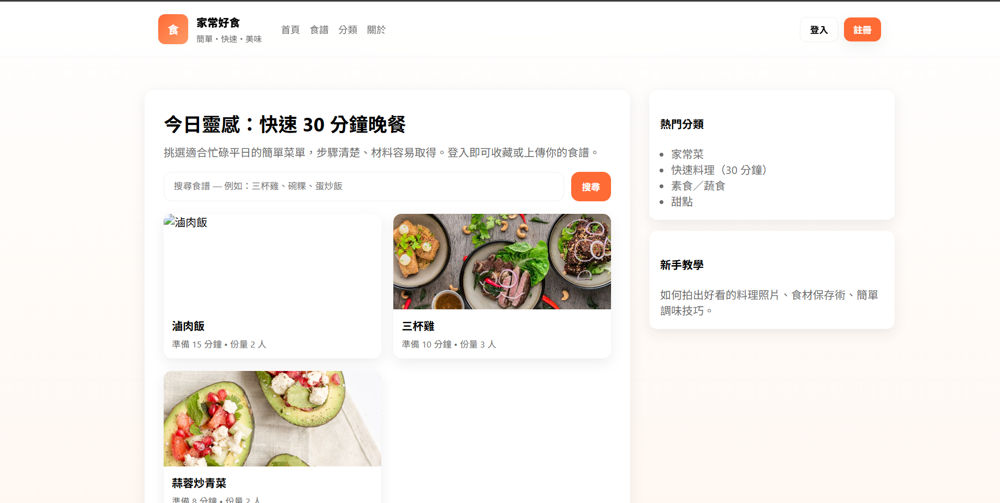
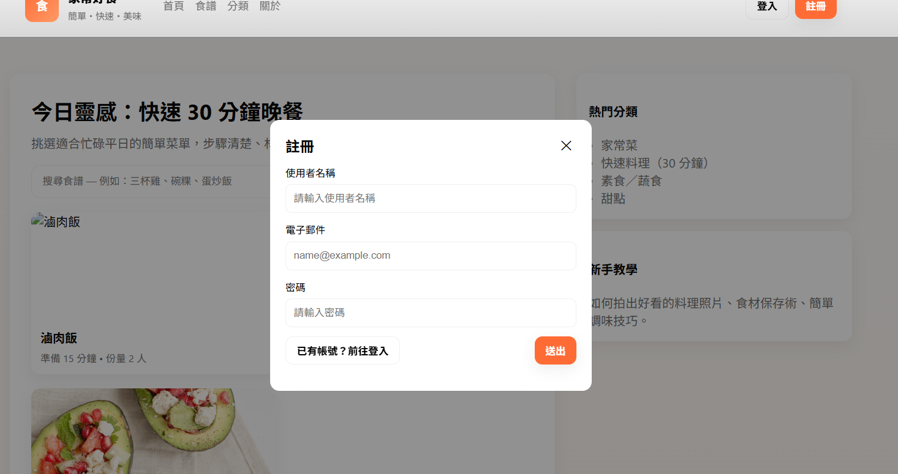
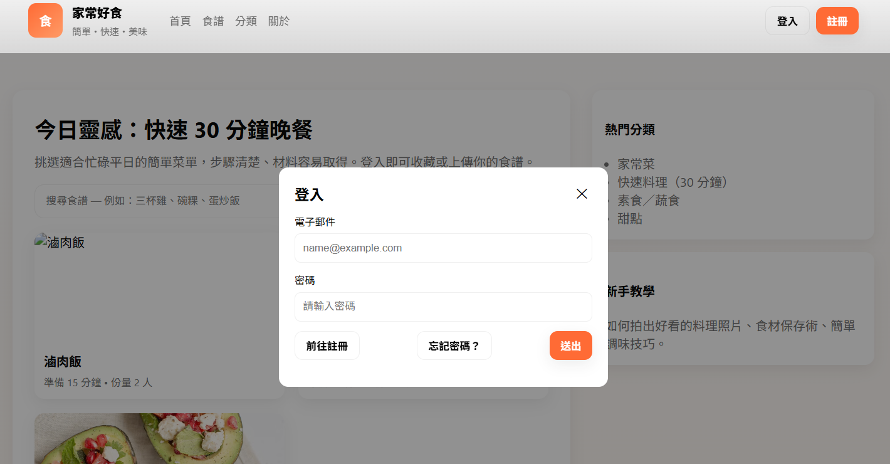
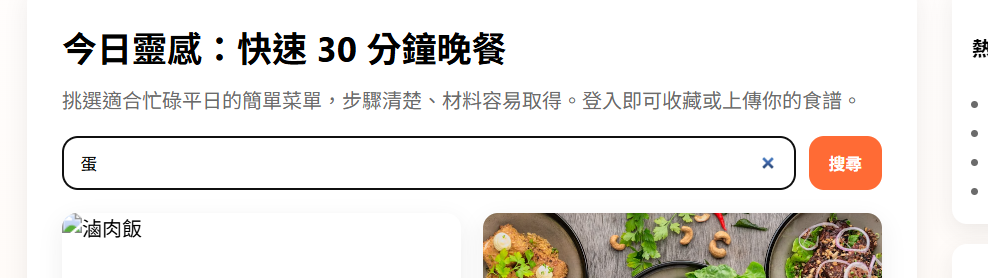
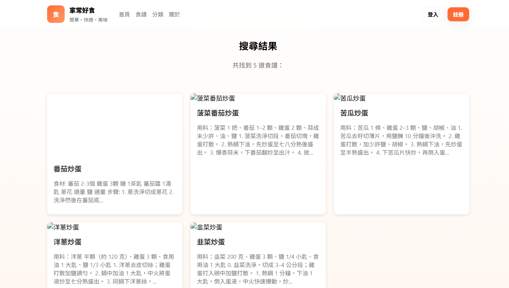
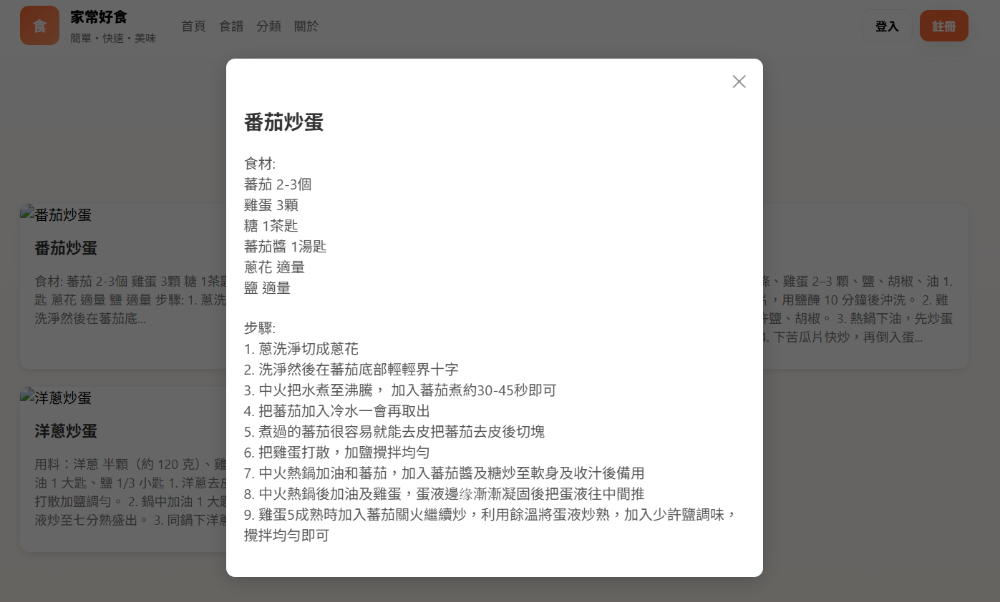

# ingredients-recognition
大學專題製作: 食材辨識與推薦系統

## Reference to training data
1. https://data.gov.tw/dataset/147690
2. https://fae.moa.gov.tw/theme_list.php?theme=topics&sub_theme=recipe

## Database
採用 MySQL (ver: 8.0) 建立 Users、Ingredients、Recipes、RecipeIngredients 與 Recipe_ratings 等資料綱目

SQL script: [recipes_ingredients.sql](./recipes_ingredients.sql)

下圖為各表的關聯規則，原檔案: [DB_design.drawio](./DB_design.drawio) 採用 https://app.diagrams.net/ 進行編輯 (暫定)

下圖為 MySQL workbench 產生的 EER diagram

## Website
首頁：

註冊與登入

搜尋食譜

顯示食譜資訊

## TODO List

1. 實時物件辨識並輸出結果至網站上

## Adjustment List

1. 實時物件辨識

## Contributors
* [Rex](https://github.com/RexIscodingnow)
* [Tao](https://github.com/5142577aa)

